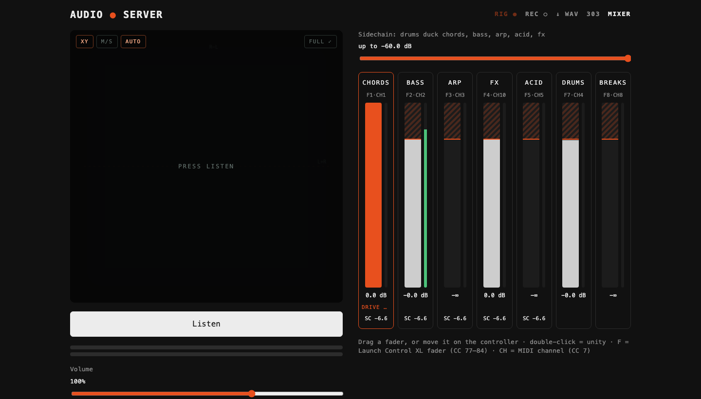
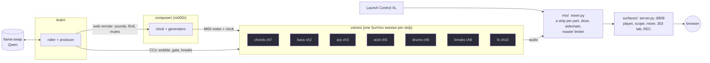
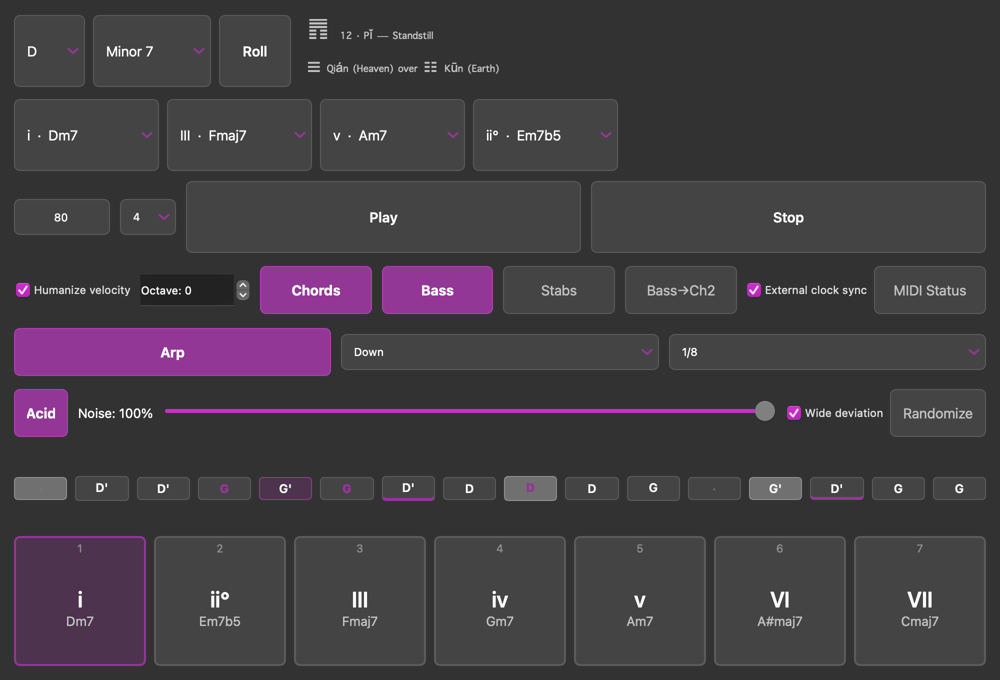
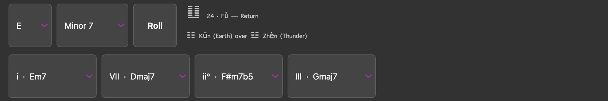
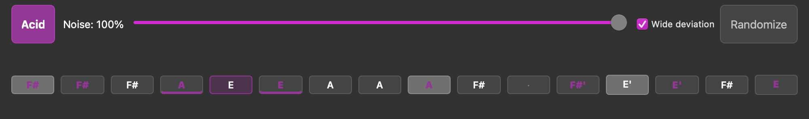
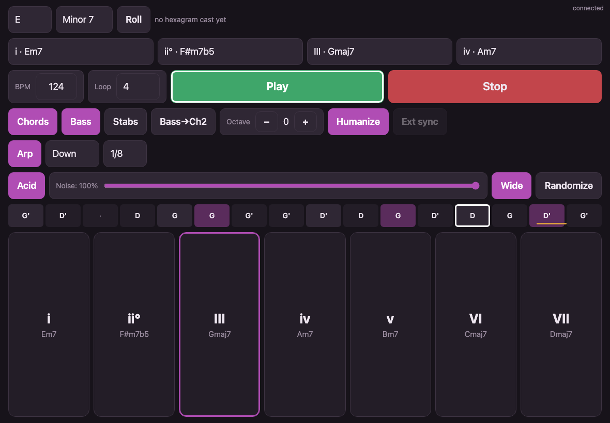

# m00Dr

**A generative techno rig that plays itself.** m00Dr composes chords, bass, arp, drums,
breaks and a 303-style acid line from I Ching casts around the circle of fifths. A SunVox
instrument plays each part, a mixer balances and dirties them, and a local language
model (Qwen, through llama-swap) steers the arrangement like a producer: it brings parts in
and out, changes sounds, gates and wobbles the bass. You listen from any browser on the
LAN, with a scope and the mixer beside it.

It runs on a Linux desktop (PipeWire). The Mac and an iPad are just browsers.

> **Status, 2026-10-31.** This repo now holds the whole rig. It was three projects (m00Dr,
> the composer; m800Dr, the audio side; m00Drc, the roller), merged here with their history.
> Every voice is SunVox. The rig has been started as one unit but not yet judged by ear in
> this form. See [What's next](#whats-next).



## How it fits together



| Folder | What's in it |
|---|---|
| `composer/` | m00Dr itself: the Qt window, the sequencer, the I Ching oracle, the iPad web remote |
| `voices/<strip>/` | one folder per mixer strip: `player.py` (the SunVox player), `build.py` (generates the patches), the `.sunvox` patches and `patches.json` |
| `voices/_sunvox/` | the shared SunVox library glue and `bank.py` (several patches per strip, chosen by program change) |
| `mix/` | `mixer.py` (JACK mixer, Launch Control XL) and `links.sh` (keeps the PipeWire graph wired) |
| `surfaces/` | `server.py` and its pages, `webrtc.py` (low-latency stream) |
| `brain/` | the roller and the Qwen producer |
| `tools/` | offline sample work: breaks, kits, the sample catalog |
| `edges/` | the Mac MIDI bridge and the `rig` command; `m8/` (Dirtywave M8, parked) |
| `systemd/` | a user unit per process and `m00dr.target` |
| `docs/` | the old READMEs, the handoff log and the roadmap |

## The voices

Each strip is one SunVox instrument with a few patches. m00Dr picks the patch with a program
change, and the patches are what the producer chooses between. Every patch is generated
by its `build.py`, and every `.sunvox` opens on its own in the SunVox app.

| Strip | MIDI | Patches | Notes |
|---|---|---|---|
| Chords | 7 | Wurli, OBX strings, Arco strings, Organ, Pad | Wurli: DX7-style FM with tempo-synced tremolo and a velocity bark. The strings and organ are multisamples, each tuned to its root. Pad: detuned saws, slow attack. |
| Bass | 2 | Fuzz, Reese | Two detuned saws whose beat locks to the tempo (one swell per beat by default); the producer's `wobble` and `gate` moves change it. |
| Arp | 3 | 10 GAMEBREAKS stabs, Phase sine | Sampled, tuned per sample, levelled. |
| Acid | 5 | 303 | Glide, saw, resonant 24 dB low-pass, saturation and crush. Live knobs on the 303 tab. |
| Drums | 6 | Machine, Boom, Crunch | Generated kits. |
| Breaks | 8 | 64 breaks, one per hexagram | Chopped on m00Dr's clock; each Roll picks the break, each chord change re-chops the bar. |
| FX | 10 | samples and live fx | |

Each strip is its own SunVox session (and process) because one session renders everything
into one stereo output. Separate sessions keep each part on its own mixer strip.

```sh
uv run voices/chords/build.py                  # regenerate a strip's patches + patches.json
uv run voices/chords/player.py --demo out.wav  # hear every patch, offline (arp, bass, chords)
```

The SunVox library (`voices/_sunvox/sunvox_lib/`) and the sample audio aren't in git.

## The producer

The roller rolls m00Dr every 2–4 minutes. In producer mode, Qwen (a 35B mixture-of-experts
model with a "music" control vector, served by llama-swap) reads the set's state: mode, tempo,
break, arrangement, and every menu m00Dr's web remote publishes. It writes a short note,
then acts. Its moves are `hold`, `strip`, `take_out`, `bring_back`, `build`, `drop`,
`sweep_out`, `push`, `gate` and `wobble`, plus setting any control, including the sound
menus (chord, bass and arp sound, drum kit).

Your hands win:

- **A fader you move by hand** caps Qwen's moves on that strip until you move it again.
- **The master limiter** (-1 dBFS peak, a sustained-level cap) is out of Qwen's reach.
- It only runs while someone is listening; the page starts and stops it.

## The page

`http://<desktop>:8808` (the screenshot at the top): **Listen** streams the mix (raw PCM or WebRTC). An XY scope sits
beside the mixer, which shows the faders, drive and meters. There's a **303 tab** for the
acid patch's knobs and **REC**, which records the mix to `~/Recordings/m800Dr/`. `/mixer` is
the mixer on its own, for a tablet.

## The composer



**Chords from theory, not presets.** Pick a key and one of eight scales (Major, Minor,
Byzantine and a generated "snhtri", each plain or with sevenths) and every diatonic chord
is built for you. The pads show what each degree sounds like (`iv · Gm7`).

**Parts on their own channels.** Chords, bass, arp, drums and acid run from one transport
and mute independently. Their sounds are the menus beside them.

**Clock.** m00Dr is MIDI Beat Clock master or follows an external clock. Tempo, loop length
(1–4 slots) and an octave shift are live.

### The Roll button



Roll rewrites the key, scale and progression as a **move around the circle of fifths**, with
the step sizes drawn by I Ching coin tosses: three coins per line, six lines per cast. The
weighting (3/8, 3/8 static; 1/8, 1/8 changing) means a roll usually nudges by one fifth and
only sometimes leaps by two. The lower trigram sets the ground (key, scale, the tonic);
the upper sets the movement (the other three slots). Each roll is relative to the last, so
the set wanders through related keys instead of teleporting. Slot 1 is always the tonic.

### The acid sequencer



A 16-step, one-bar pattern written in scale degrees relative to the bar's chord root, so it
respells itself as the progression moves. It's generated from what transcribed 303 lines
actually do: they're root-heavy, built from **octave jumps, accents and slides** over a tiny
palette. So each step is dealt four I Ching lines (what, which octave, accent, slide), and
the palette is cast once per pattern, which makes it a riff and not a wander. Slides are
real: the sliding step's note-off goes out after the next note-on, so the synth glides.
**Noise** sets how much of the cast comes through, and **Wide deviation** how far round the
circle of fifths the palette reaches.

### Drums

One I Ching cast per Roll (a draw per voice per step), morphed by the mutation control
(also CC 19, Launch Control XL column 7) from four-on-the-floor house through UK garage
two-step to broken breakbeat, reversibly.

### Playing from an iPad



Tick **Web remote** and open the address it shows (`<host>:8765`) on any device on the same
network. It's the same window, not a copy: both sides drive the same controls, so they can't
disagree. If the iPad drops off Wi-Fi mid-chord, the notes are released. It has no password,
so it's off by default. The producer controls m00Dr through this same remote.

## Running it

From the Mac (or anywhere with ssh to the desktop as `cacheos`), with `edges/mac/rig` on
your PATH:

```sh
rig up       # checks someone is logged in, starts m00dr.target, presses Play, opens the page
rig status   # "all good", or what isn't running; and whether the producer is on
rig log      # follow the producer: its notes, every action and its result
rig down     # stops everything, puts the mix back, unloads the model
```

On the desktop itself: `systemctl --user start m00dr.target`. Install the units with
`cp systemd/*.service systemd/m00dr.target ~/.config/systemd/user/ && systemctl --user daemon-reload`.

Needs: Linux with PipeWire (the voices and mixer use PipeWire/JACK and ALSA sequencer),
[uv](https://docs.astral.sh/uv/), the SunVox library in `voices/_sunvox/sunvox_lib/`, and,
for the producer, llama-swap serving the model named in `systemd/m00drc-roller.service`.
m00Dr is still a Qt app, so it needs a desktop session; a locked screen is fine (the desktop logs
in at boot).

The composer alone runs on any machine and drives external gear over MIDI:

```sh
uv sync
uv run python composer/main.py
uv run pytest composer/tests     # 233 tests
```

## What's next

- **First full listen** of the merged rig, then delete the leftover FluidSynth files.
- **Headless composer** (nice to have): run m00Dr's engine without the Qt window, so the rig
  doesn't depend on a desktop session at all and the page is the only interface.
- **Fewer processes**: one process holding one SunVox library copy per strip (strips stay
  separate).
- **MIDI out to hardware** (branch `midi-out`): send m00Dr's parts to physical instruments.
- **WebRTC doesn't connect from Chrome on the Mac** (it never has; the iPad's does). Use
  **RAW** under Stream there.
- Unit names still carry the old project names (`m800dr-*`, `m00drc-*`).
- Known gaps: the Reese doesn't have `voices/reference/reese.py`'s bright attack; a
  "Tremolo violins" chord set was left out (its octave couldn't be pinned down).
- The Dirtywave M8 integration (`edges/m8/`) is parked.

## History

m00Dr started in 2019 as a Kivy app: a MIDI chord generator that only half worked (tag
`v0-2019`, branch `legacy-kivy`). It grew a working clock, a Qt UI and the generators. Then
came a desktop audio rig (m800Dr) with FluidSynth, then SunVox synths and a roller
(m00Drc), and finally a local model steering it all. In October 2026 the three were merged
into this repo, and every voice moved to SunVox. The design history is in
[`docs/ROADMAP.md`](docs/ROADMAP.md) and [`docs/HANDOFF.md`](docs/HANDOFF.md).
